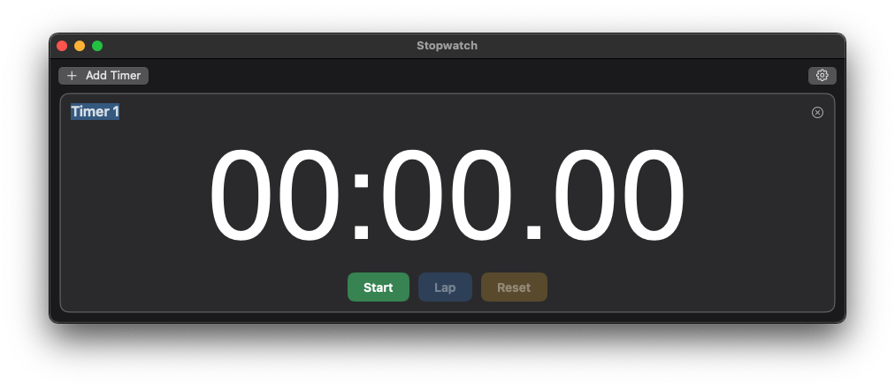
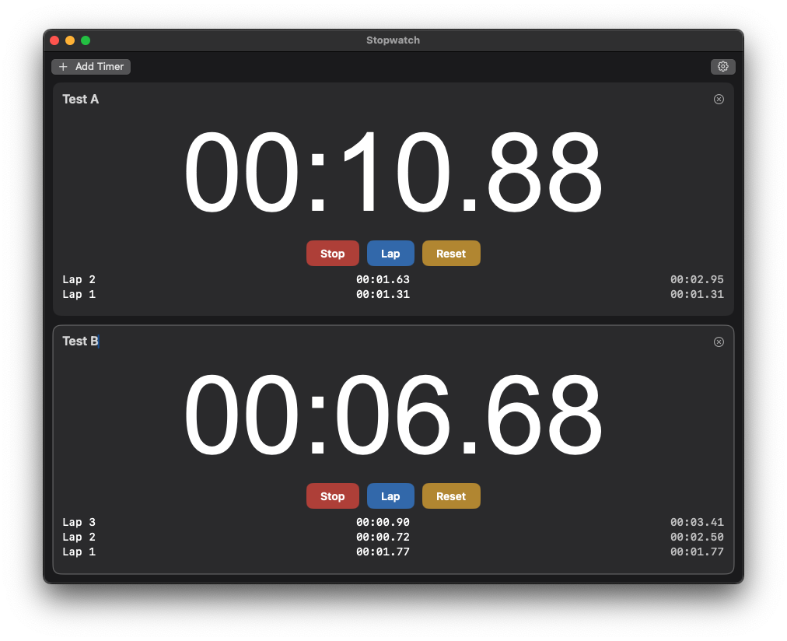
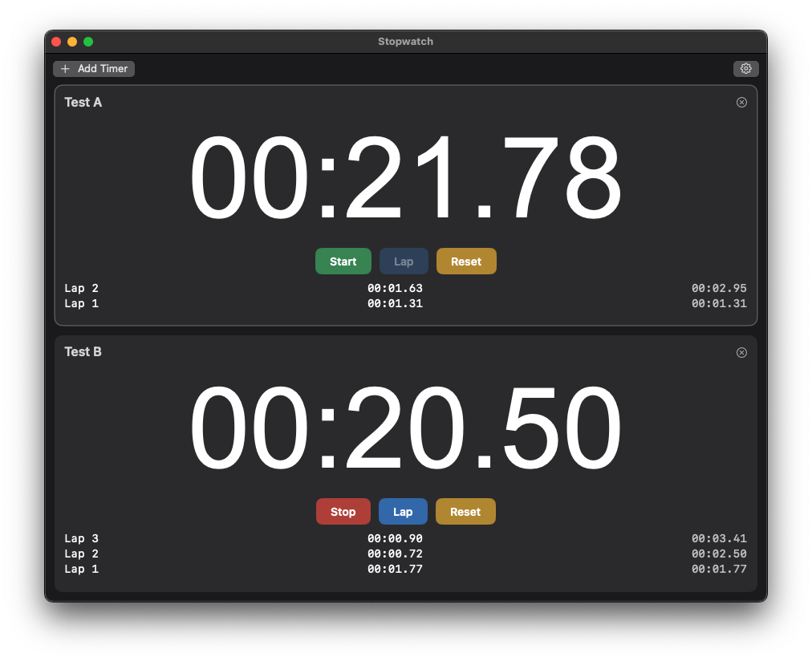
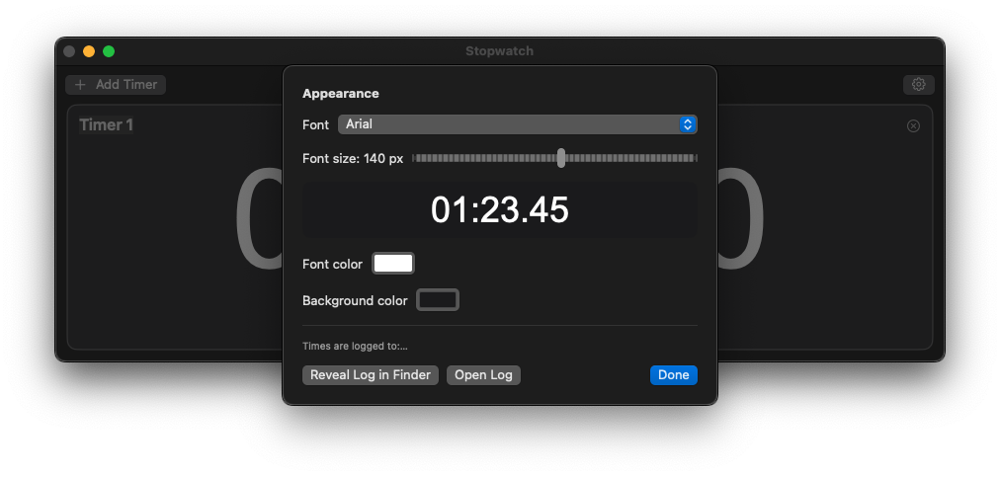

Stopwatch
=========

```
swiftc -parse-as-library -O StopwatchApp.swift -o Stopwatch && ./Stopwatch
```

Build Stopwatch into a full on Apple Application
------------------------------------------------
```
build_app.sh
sudo xattr -dr com.apple.quarantine /Applications/Stopwatch.app
``





